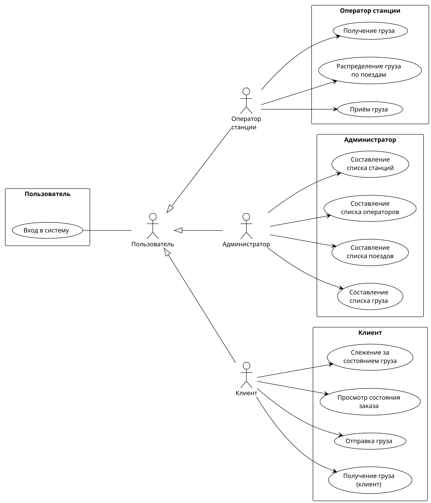

# Разобранный пример: диаграмма вариантов использования «Железная дорога»

Содержание: [Ситуация](#ситуация) · [Разбор образца](#разбор-образца) · [Готовый код](#готовый-код) · [Что здесь важно](#что-здесь-важно)

## Ситуация

Пользователь прислал образец раскладки (скриншот из редактора) и попросил сделать так же аккуратно. Сначала он просил добавить `<<include>>` от каждого варианта ко входу, потом решил, что `include` лишние, и велел о них забыть. **На диаграмме их нет, и без прямой просьбы добавлять их не нужно.**

## Разбор образца

Так выглядит шаг 1 из раздела «Если пользователь прислал картинку» (выписать всё словами):

- **Слева** блок «Пользователь» с вариантом «Вход в систему».
- **Актёр «Пользователь»** связан простой ассоциацией со входом. От него обобщение (пустой треугольник у «Пользователя») к трём актёрам.
- **Актёры сверху вниз:** Оператор станции, Администратор, Клиент.
- **Справа блоки, названные по актёрам**, с вариантами использования:
  - «Оператор станции»: получение груза, распределение груза по поездам, приём груза.
  - «Администратор»: составление списков станций, операторов, поездов, груза.
  - «Клиент»: слежение за состоянием груза, просмотр состояния заказа, отправка груза, получение груза (клиент).
- Каждый актёр связан стрелкой со своими вариантами использования.
- Внешней рамки системы на образце нет.

## Готовый код

Проверен рендером: собирается без ошибок, кириллица отображается корректно, раскладка совпадает с образцом.

## Что здесь важно

- **Порядок актёров сверху вниз** (оператор, администратор, клиент) задан строками `O -[hidden]right-> A` и `A -[hidden]right-> C`. В режиме `left to right direction` PlantUML поворачивает направления: `-[hidden]down->` и `-[hidden]up->` порядок **не** задают (актёры меняются местами), а `-[hidden]right->` задаёт вертикальный порядок.
- **Порядок объявления сам по себе не помогает.** Проверено на всех 6 перестановках объявления актёров, групп и связей: ни одна не дала нужный порядок.
- **Невидимые связи между самими блоками групп не нужны**, они дали «лесенку» и ухудшили раскладку.
- `L -- U` (без стрелки) ставит «Вход в систему» левее актёра «Пользователь», а `U <|-- O` ставит «Пользователь» левее потомков. **Сторона элемента определяется порядком записи связи**, а не направлением стрелки.
- Блок «Пользователь» с одним вариантом получает заголовок с двумя переводами строки (`"Пользователь\n\n"`), иначе заголовок налезает на овал.
- `skinparam linetype ortho` для такой диаграммы не нужен: обычные изогнутые линии читаются лучше.
- Если нужна рамка «Система «Железная дорога»», оберни в `rectangle "Система «Железная дорога»" { ... }` только блоки с вариантами использования, без актёров.
