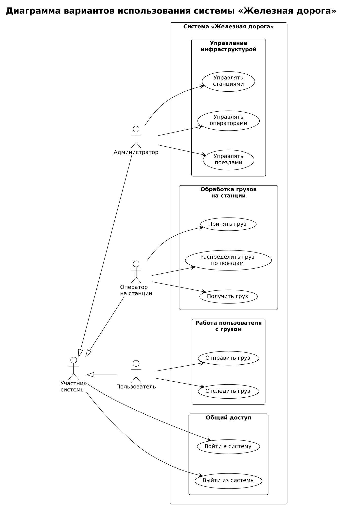
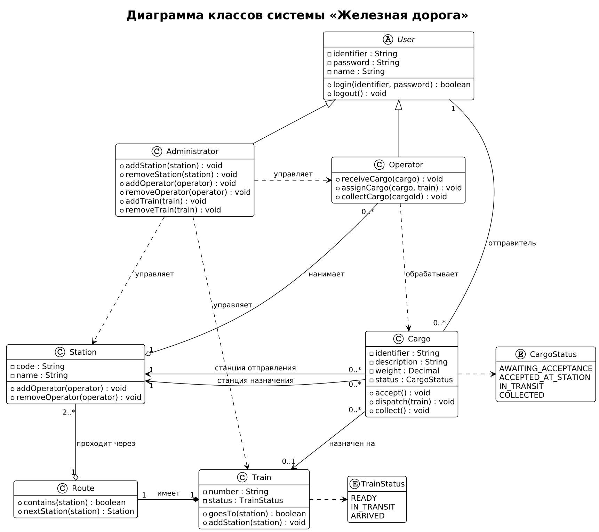

# Примеры (проверены рендером, PlantUML 1.2025.4)

## Диаграмма вариантов использования «Железная дорога»

Актёр-родитель «Участник системы» держит вход/выход, без `include`. `left to right direction`, плавные линии (без `linetype`).

## Диаграмма классов «Железная дорога»

Иерархия сверху, `Station` в центре, направления заданы вручную, без пакетов, enum сбоку.

