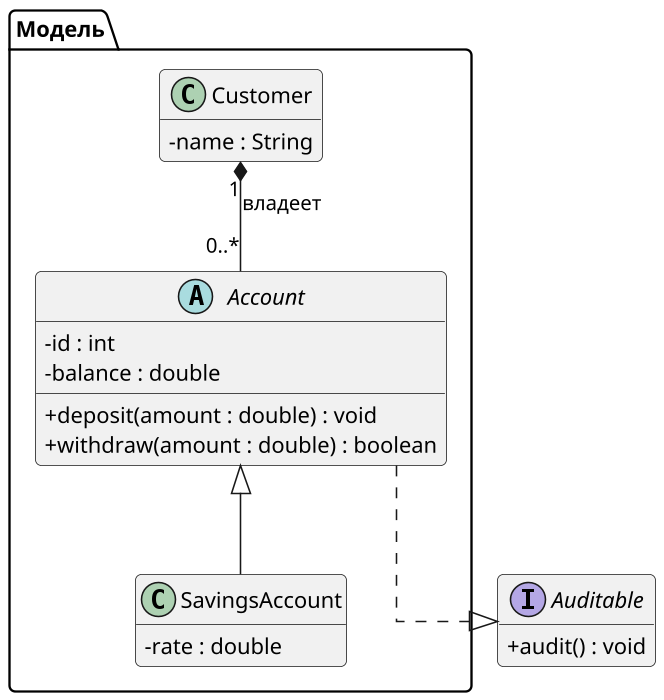
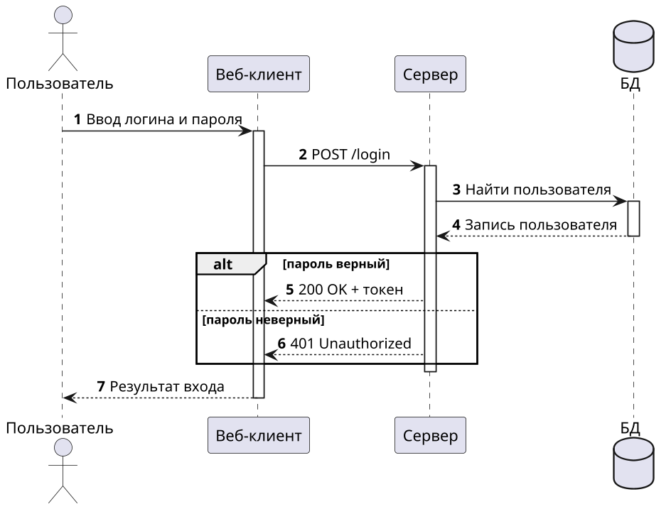
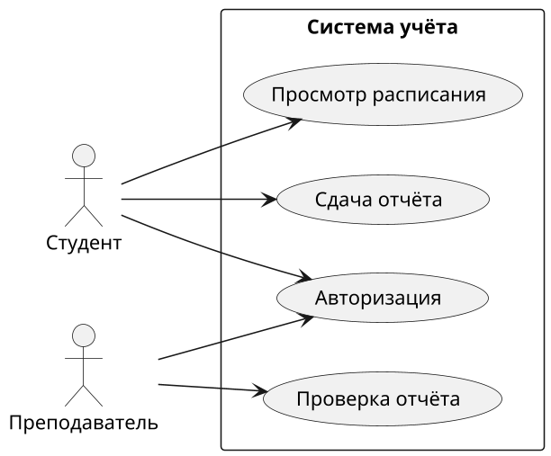
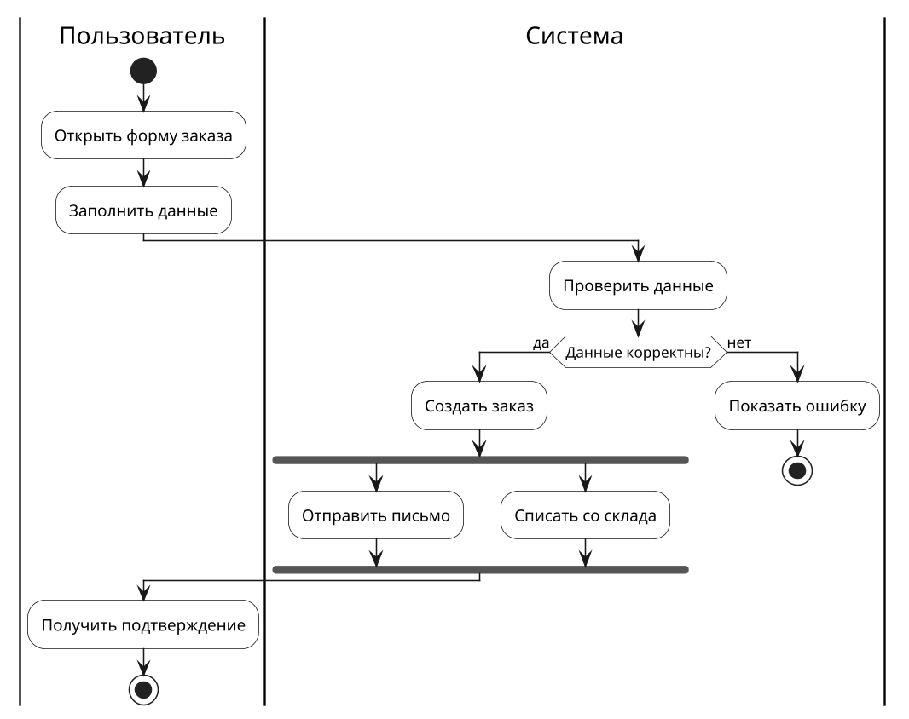
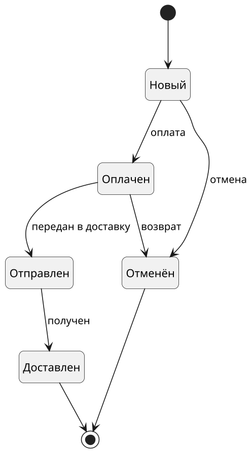
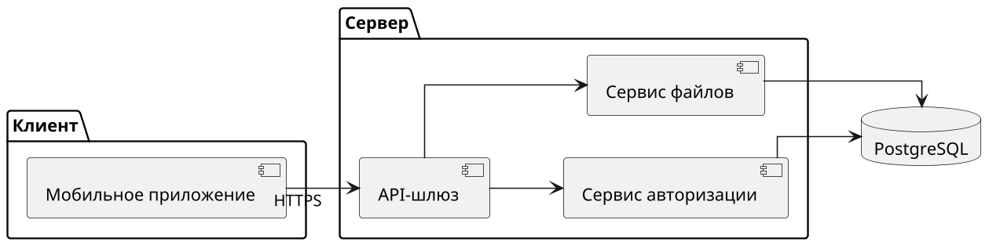
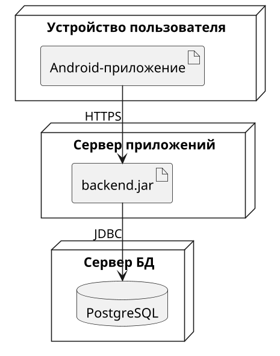
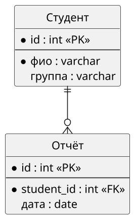
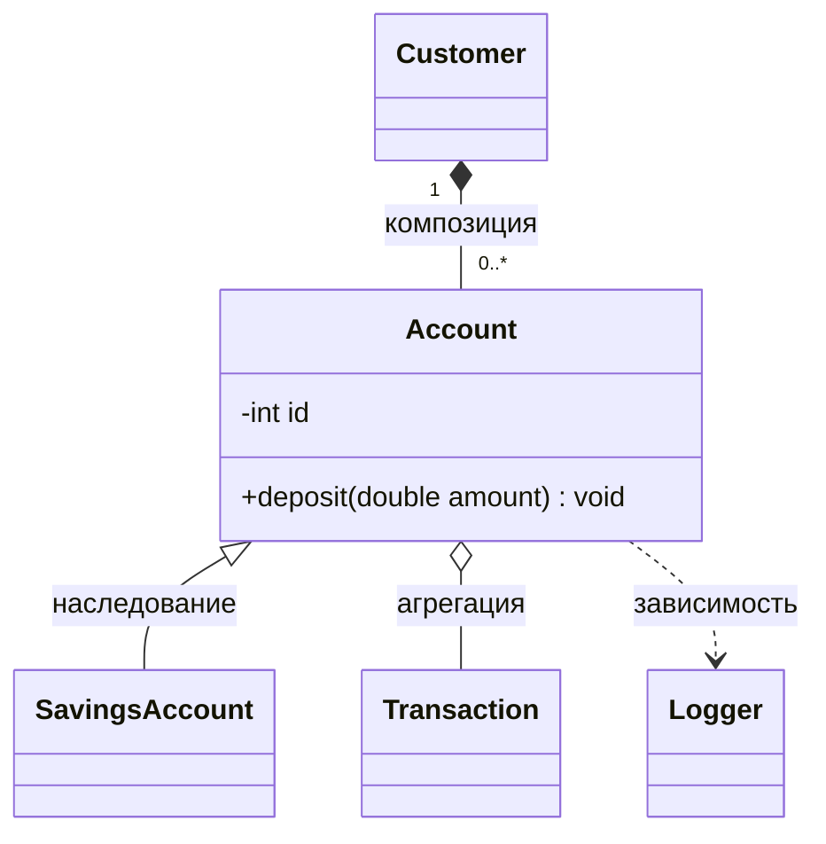
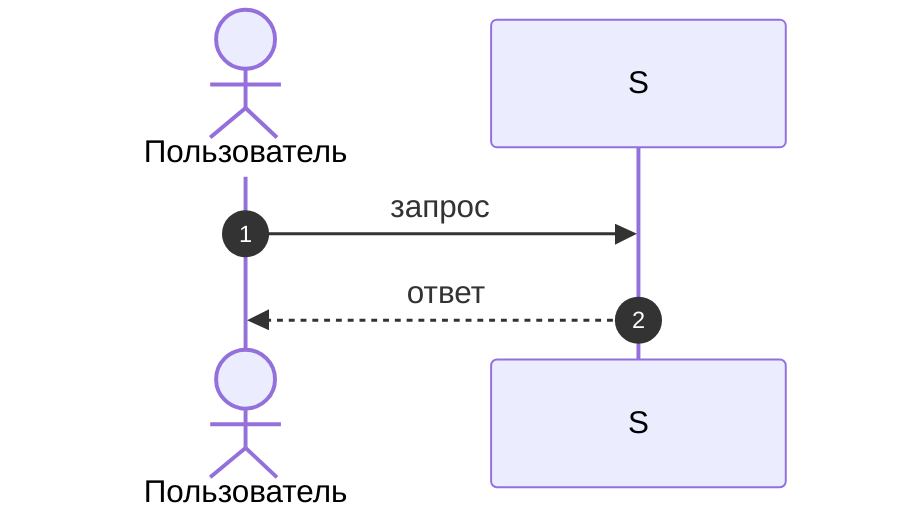

# Шаблоны PlantUML по типам диаграмм

Содержание: [Классы](#классы) · [Последовательность](#последовательность) · [Варианты использования](#варианты-использования) · [Активность](#активность) · [Состояния](#состояния) · [Компоненты](#компоненты) · [Развёртывание](#развёртывание) · [ER-диаграмма](#er-диаграмма) · [Mermaid](#mermaid)

Каждый шаблон — готовая «шапка» плюс каркас. Копируй шапку целиком, затем подставляй содержимое. Для чёрно-белой печати добавь `!theme plain` сразу после `@startuml`.

---

## Классы

Заметки: главные классы расставляй вверху, зависимые ниже. Для управления положением используй `-down->`, `-right->`.

---

## Последовательность

Заметки: не больше 4–6 участников. Синхронный вызов — `->`, ответ — `-->`, асинхронный — `->>`. Условия — `alt/else/end`, циклы — `loop`, необязательные блоки — `opt`.

---

## Варианты использования

Заметки: актёры всегда снаружи рамки системы, варианты использования внутри. Связи `<<include>>` (обязательная часть сценария) и `<<extend>>` (необязательное расширение) по умолчанию **не рисуй**: добавляй только если они прямо нужны по заданию или есть на образце. Лишние связи портят читаемость.

---

## Активность

Используй новый синтаксис (`start`, `:действие;`), а не устаревший.

Заметки: дорожки (`|Название|`) группируют действия по исполнителям. Параллельные ветки — `fork / fork again / end fork`. Циклы — `while (условие?) is (да) ... endwhile (нет)`.

---

## Состояния

Заметки: у каждого состояния должен быть путь входа и выхода. Охранные условия пиши в квадратных скобках: `: событие [условие] / действие`.

---

## Компоненты

---

## Развёртывание

---

## ER-диаграмма

Для БД удобен нативный синтаксис PlantUML (IE-нотация):

Обозначения связей: `||` ровно один, `o|` ноль или один, `}o` ноль или много, `}|` один или много.

---

## Mermaid

Запасной вариант, когда нужен Markdown или GitHub.

Классы:

Последовательность:

Связи в Mermaid: `<|--` наследование, `*--` композиция, `o--` агрегация, `-->` ассоциация, `..>` зависимость, `..|>` реализация.
